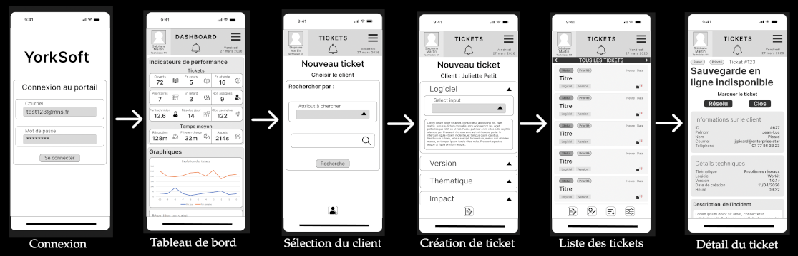
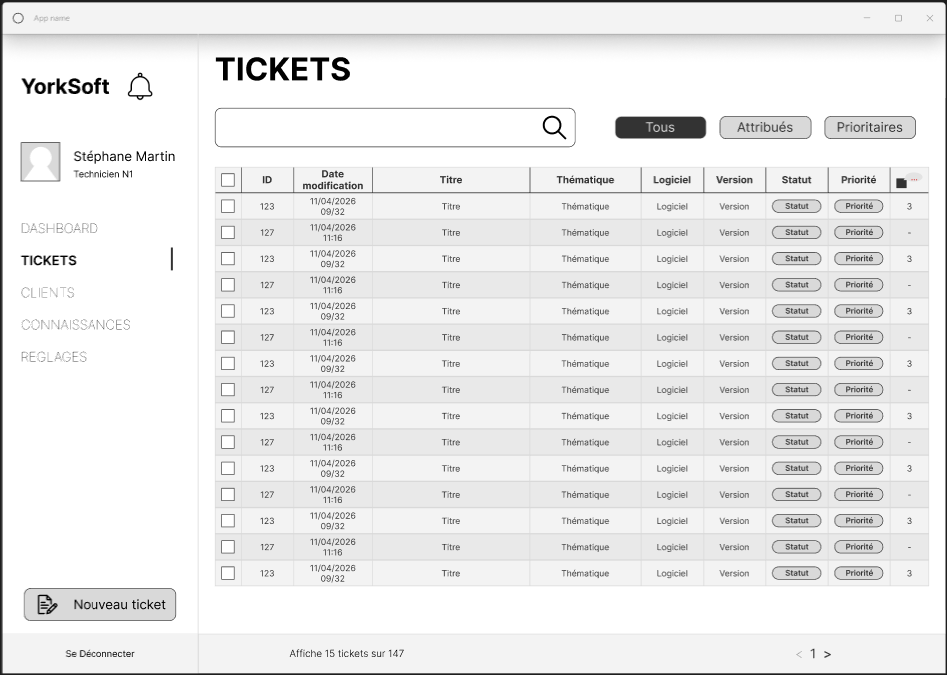

# Suivi MNS

Web-based ticketing (support/helpdesk) application built as part of a **CDA (Concepteur Développeur d'Applications)** software developer certification capstone project.

A client reports an incident on a software product they use; the support team (technician → manager → director) qualifies it, assigns it, works it and closes it, with SLA tracking and automatic prioritization.

The business context is a fictional software vendor, **YorkSoft** (hence the repo's name), whose support desk needed a shared, traceable way to track client requests instead of scattered phone/email follow-ups.

> Stack: **Angular 21** (Tailwind CSS + DaisyUI) · **Spring Boot 3** (Java 17, Hibernate) · **PostgreSQL** (Docker)

## Table of contents

- [Features](#features)
- [Tech stack](#tech-stack)
- [Design](#design)
- [Getting started](#getting-started)
- [Documentation](#documentation)
- [Project status](#project-status)

## Features

- **Full ticket lifecycle**: opening, qualification (theme/urgency/impact), automatic priority and SLA calculation, assignment, handling, on-hold states (waiting on client / third party), resolution, closing.
- **Role-based dashboards**: KPIs, charts and a recent-activity feed for administrators, directors, managers and technicians.
- **Business reference data management** (full CRUD, admin-only): software and software types, versions and version types, themes, urgency levels, impact levels, statuses.
- **Client records** and management of the software licenses tied to them.
- **Comment thread and activity history** on every ticket, for traceability of exchanges and actions.
- **Knowledge base**: linking resolution articles/procedures to tickets.
- **Role-based authentication** (JWT) with five profiles: Admin, Director, Manager, Technician, Client.
- Responsive UI with dedicated desktop/mobile views for ticket lists.
- **Public demo mode** (optional): visitors can try the app with a temporary technician account, without signing up.

## Tech stack

| | |
|---|---|
| **Frontend** | Angular 21 (standalone components, signals) · Tailwind CSS 4 · DaisyUI 5 · Chart.js |
| **Backend** | Spring Boot 3.2 (Java 17) · Spring Security (JWT) · Spring Data JPA / Hibernate · MapStruct |
| **Database** | PostgreSQL 18, containerized (Docker) |
| **API documentation** | Auto-generated OpenAPI / Swagger UI (springdoc) |
| **CI/CD** | GitHub Actions (build, tests, Docker image, deployment) |

Design rationale and details: see [Documentation](#documentation) below.

## Design

The UX was designed mobile-first in Figma before implementation, then adapted to a desktop-first layout for what turned out to be the primary use case (a support team working the queue day to day). These are the original design-phase mockups, not live screenshots — the shipped UI follows this structure but is rougher around the edges in places.





## Getting started

Prerequisites: Java 17, Node.js 20+, Docker.

### 1. Database

```bash
docker run --name suivi-mns-db -e POSTGRES_USER=root -e POSTGRES_PASSWORD=root -e POSTGRES_DB=db -p 5432:5432 -d postgres:18
```

### 2. Backend

```bash
cd backend
./mvnw spring-boot:run -Dspring-boot.run.profiles=dev
```

The `dev` profile (`application-dev.properties`) points directly at the local database above and recreates the schema on every startup — no extra configuration needed for local development.

To run with the default profile instead (the one used in production, fully driven by environment variables), copy `backend/.env.example` to `backend/.env` and adjust it.

The API starts on `http://localhost:8080` (Swagger docs at `/swagger-ui.html`).

### 3. Frontend

```bash
cd frontend
npm install
npm start
```

The app is served on `http://localhost:4200` and calls the API on `http://localhost:8080` (see `frontend/src/environments`).

## Documentation

- [docs/ARCHITECTURE.md](docs/ARCHITECTURE.md) — project-wide overview, security model, known issues
- [backend/docs/ARCHITECTURE.md](backend/docs/ARCHITECTURE.md) — backend stack, data model (MCD/MLD), ticket lifecycle
- [backend/docs/API.md](backend/docs/API.md) — authentication, roles, REST API resources
- [frontend/docs/ARCHITECTURE.md](frontend/docs/ARCHITECTURE.md) — frontend stack, project layout
- [docs/SERVER_SETUP.md](docs/SERVER_SETUP.md) — VPS, domain and CI setup for the showcase deployment, remaining pre-launch tasks

## Project status

The core ticket workflow (open → assign → work → resolve → close, with priority, SLA and history) works end to end and is backed by a substantial automated test suite (backend unit + integration tests via JUnit/MockMvc, frontend unit tests via Vitest — see [docs/ARCHITECTURE.md](docs/ARCHITECTURE.md#testing)). Still in progress or not started:

**Features**
- Role-based dashboards: functional for managers and technicians, still very incomplete for directors and admins, and many planned KPIs/charts aren't built for any role yet
- Internal user management beyond account creation (edit, deactivate)
- Knowledge base UI (the backend exists, the dedicated UI is still to be built)
- Client-facing portal (clients currently go through a technician, not the app directly)
- Notifications and alerts (approaching/breached SLA, new assignments...)
- Mobile responsive ticket list — the mobile layout still renders the desktop table instead of a card-based view
- Internationalization — the app is French-only today

**Engineering hardening**
- **Security**: short-lived JWTs with refresh/auto-renewal (tokens currently don't expire and can't be revoked before that), and a systematic review against the OWASP Top 10
- **Data**: a schema migration tool (Flyway/Liquibase) instead of Hibernate `ddl-auto`, and an automated, tested backup/restore procedure (none exists yet)
- **GDPR and accessibility (RGAA/WCAG) compliance** — not addressed yet: no defined retention policy, no right-to-erasure flow, no formal accessibility audit
- Deeper frontend tests (current ones mostly check that components construct, not real interaction behavior) and some browser-driven end-to-end coverage

## Author

Project built by Benoit Champlon as part of the CDA certification.
