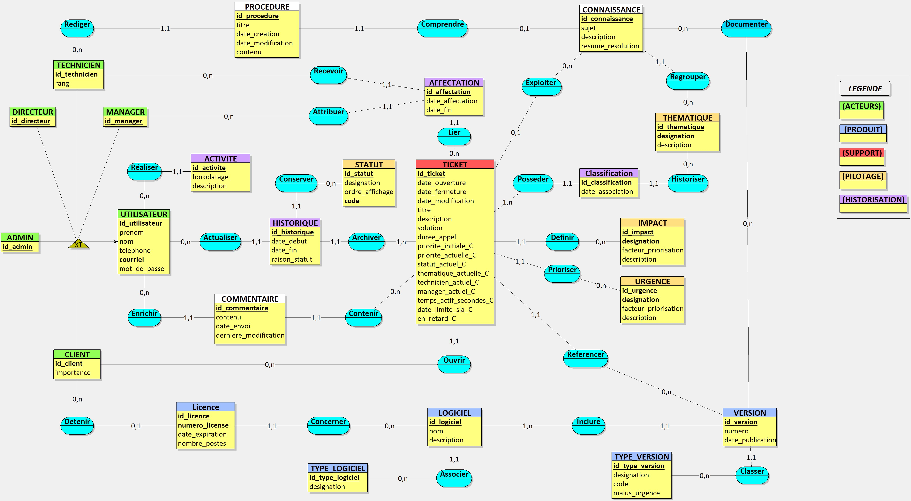
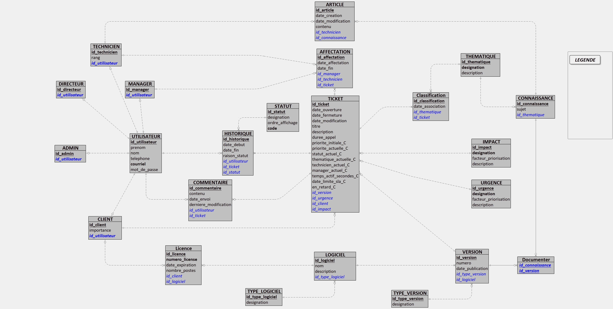
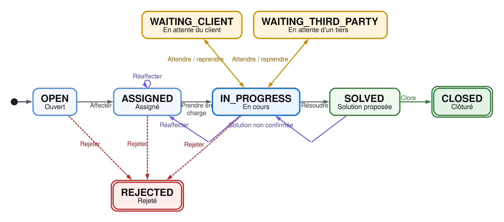
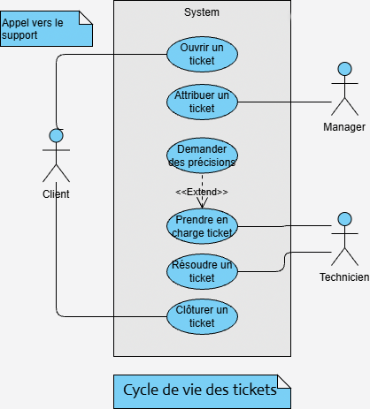

# Backend architecture

Backend-specific details. See [../../docs/ARCHITECTURE.md](../../docs/ARCHITECTURE.md) for the project-wide overview, security model and known issues, and [API.md](API.md) for the REST API surface.

## Stack

| Component | Choice | Role |
|---|---|---|
| Framework | Spring Boot 3.2.5 (Java 17) | REST API |
| Persistence | Spring Data JPA / Hibernate | ORM |
| Database | PostgreSQL 18 | Relational storage |
| Security | Spring Security + JJWT | Stateless JWT authentication |
| DTO ↔ Entity mapping | MapStruct | Mappers generated at build time |
| API documentation | springdoc-openapi | Auto-generated Swagger UI |
| Build | Maven | — |

## Package layout (`backend/src/main/java/com/mns/cda/suivimns`)

| Package | Content |
|---|---|
| `controller` / `controller/business` | REST entry points |
| `service`, `service/entity`, `service/business`, `service/workflow`, `service/search` | Business logic, including the ticket lifecycle engine (`service/workflow`) |
| `model`, `model/keys`, `model/groups` | JPA entities |
| `dto` (`entity`, `flat`, `details`, `search`, `workflow`, `account`, `dashboard`, `config`) | Objects exchanged with the frontend, split by use case |
| `mapper`, `mapper/entity`, `mapper/enumerate` | MapStruct entity ↔ DTO mappers |
| `security` | JWT authentication, filter, role annotations (`@IsAdmin`, `@IsManager`...) |
| `dao`, `dao/search` | Custom queries (search/filtering) |
| `enumerate` | Business enums (`StatusEnum`, `ActivityType`) |
| `exception` | Error handling |
| `config` | Spring configuration (CORS, beans...) |

## Data model

The model is centered on the `Ticket` entity, linked to business reference data (`Theme`, `Urgency`, `Impact`, `Version`/`VersionType`, `Software`/`SoftwareType`, `Client`) and to its history (`Assignment`, `Comment`, `Classification`, `History`).

**Conceptual data model (MCD)**

**Logical data model (MLD)**

The physical schema (24 tables) is generated from these JPA entities. Foreign keys mostly cascade or null out sensibly on delete — e.g. deleting a ticket cascades to its assignments, but deleting a technician only nulls out `id_technician` on their past assignments, preserving the historical record instead of losing it.

`Ticket` itself stores a **denormalized projection** of its current state (status, priority, current technician, active time, SLA deadline, overdue flag) alongside the authoritative, append-only `History`/`Assignment`/`Classification` tables. This is a deliberate read-performance tradeoff — ticket lists and dashboards read the projection directly instead of re-deriving it via joins on every request — maintained by the `service/workflow` services on every write. When adding a new derived/current-state field to `Ticket`, keep it in sync the same way rather than computing it ad hoc in a controller.

Priority isn't entered directly by the ticket creator: it's computed from urgency, impact and ticket context into a 0–100 score, which in turn drives the SLA deadline. This logic is intentionally centralized in the workflow services rather than spread across the frontend, so the scoring approach can change without touching the API contract.

Alongside the ticket-scoped `History`, a separate `Activity` log records user-level events (ticket opened, comment posted, procedure published...) feeding the dashboards' recent-activity widget. Its type is deliberately split across two classes: `enumerate.ActivityType` is the compile-time-safe value services pass to `ActivityService.log(...)`, resolved at write time against `model.ActivityType` — a DB-backed catalog row (`designation`, display `name`, `iconAddress`) via `ActivityTypeDao.findByDesignation(...)` — so the frontend can render icons/labels for activity types without a redeploy. Adding a new activity type means adding both the enum constant and its catalog row (seeded in `data-init.sql`/`data-prod.sql`); logging is a hard failure (`IllegalStateException`) if the catalog row is missing.

## Users and roles

`AppUser` is the parent class (JPA `JOINED` inheritance) for every account type: `Admin`, `Director`, `Manager`, `Technician`, `Client`. The role is derived from the account subtype at login time and encoded as a claim in the JWT (`role`, along with `name`, `id`, `rank`).

Each controller/method is protected by a business-level annotation (`@IsAdmin`, `@IsDirector`, `@IsManager`, `@IsTechnician`, `@IsClient`, `@IsEmployee`, `@IsUser`), which wraps Spring Security's `@PreAuthorize` — see `backend/src/main/java/com/mns/cda/suivimns/security`.

## Ticket lifecycle

A ticket's status (`StatusEnum`) follows this progression:

Notably, `REJECTED` is reachable from `OPEN`, `ASSIGNED` and `IN_PROGRESS` (not only from the start), and an unconfirmed solution sends the ticket back to `IN_PROGRESS` from `SOLVED` rather than closing it — `StatusTransition` is the single source of truth for which transitions are legal; the backend rejects anything else rather than trusting the frontend to only offer valid actions.

Each transition is handled by a dedicated service under `service/workflow` (`TicketOpeningService`, `TicketAssignmentService`, `TicketProgressService`, `TicketWaitService`, `TicketSolvedService`, `TicketClosingService`, `StatusTransition`), which keeps the business rules of each step isolated (priority calculation, SLA, internal notifications...).

Every ticket carries an initial and a current priority (computed from urgency/impact — see [Data model](#data-model)), an SLA deadline (`slaDeadline`) and an overdue flag (`overdue`).

The actors driving this lifecycle map directly onto the role model:

## Search, filtering and pagination

Ticket search combines an open-ended set of optional filters (status, client, software, version, technician, dates, keyword, priority, SLA breach). Rather than a `findBy...` method per filter combination, `dao/search` builds each criterion as a `Specification` and composes only the ones present in the request; sortable fields are restricted to an explicit whitelist rather than accepting an arbitrary field name from the client. Dashboard aggregations use JPQL where the projection is simple and native SQL for time-based aggregates (e.g. average time-to-pickup via `EXTRACT(EPOCH FROM ...)`), trading some Postgres-specific coupling for readable aggregation queries.

## Testing

Unit tests per layer (DTO validation, isolated service-level business rules like illegal status transitions or priority/SLA calculation, controller HTTP status + delegation, security/ownership checks) plus full-stack integration tests that boot the real Spring context and drive it through MockMvc with a real security config and a test-data factory — e.g. assign → pick up → hold/resume → resolve → close is covered end to end at the API level. Run with `./mvnw test`.

## Conception

Original database-design artifacts (MCD/MLD sketches from the [Looping](https://www.looping-vad.com/) modeling tool, predating the final JPA-generated schema above) live under [conception/](conception/), kept for historical reference.
