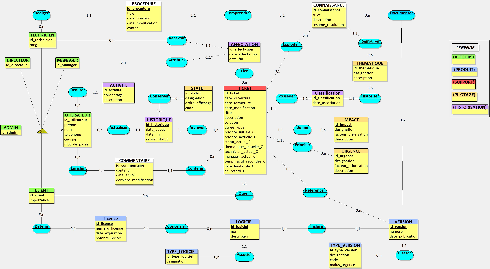
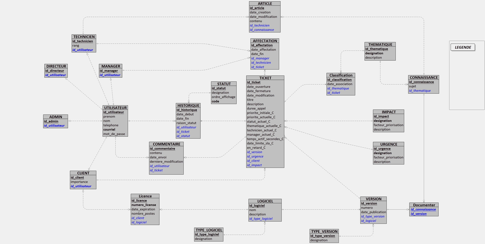

# Architecture

## Overview

Suivi MNS is a ticketing (support/helpdesk) application split into two independent applications that communicate over a REST API:

```
┌─────────────────────┐        REST / JSON + JWT        ┌──────────────────────┐        JDBC        ┌──────────────┐
│   frontend/          │ ───────────────────────────────▶ │   backend/            │ ──────────────────▶ │  PostgreSQL   │
│   Angular 21          │ ◀─────────────────────────────── │   Spring Boot 3.2      │ ◀────────────────── │  (Docker)     │
│   Tailwind + DaisyUI  │                                   │   Spring Data JPA      │                     └──────────────┘
└─────────────────────┘                                   └──────────────────────┘
```

The repo is a monorepo: `backend/` and `frontend/` are two independently deployable projects (each has its own `Dockerfile` and `compose.yml`), kept together here to share a common history and documentation.

## Backend

### Stack

| Component | Choice | Role |
|---|---|---|
| Framework | Spring Boot 3.2.5 (Java 17) | REST API |
| Persistence | Spring Data JPA / Hibernate | ORM |
| Database | PostgreSQL 18 | Relational storage |
| Security | Spring Security + JJWT | Stateless JWT authentication |
| DTO ↔ Entity mapping | MapStruct | Mappers generated at build time |
| API documentation | springdoc-openapi | Auto-generated Swagger UI |
| Build | Maven | — |

### Package layout (`backend/src/main/java/com/mns/cda/suivimns`)

| Package | Content |
|---|---|
| `controller` / `controller/business` | REST entry points |
| `service`, `service/entity`, `service/business`, `service/workflow`, `service/search` | Business logic, including the ticket lifecycle engine (`service/workflow`) |
| `model`, `model/keys`, `model/groups` | JPA entities |
| `dto` (`entity`, `flat`, `details`, `search`, `workflow`, `account`, `dashboard`, `config`) | Objects exchanged with the frontend, split by use case |
| `mapper`, `mapper/entity`, `mapper/enumerate` | MapStruct entity ↔ DTO mappers |
| `security` | JWT authentication, filter, role annotations (`@IsAdmin`, `@IsManager`...) |
| `dao`, `dao/search` | Custom queries (search/filtering) |
| `enumerate` | Business enums (`StatusEnum`, `ActivityType`) |
| `exception` | Error handling |
| `config` | Spring configuration (CORS, beans...) |

### Data model

The model is centered on the `Ticket` entity, linked to business reference data (`Theme`, `Urgency`, `Impact`, `Version`/`VersionType`, `Software`/`SoftwareType`, `Client`) and to its history (`Assignment`, `Comment`, `Classification`, `History`).

**Conceptual data model (MCD)**



**Logical data model (MLD)**



### Users and roles

`AppUser` is the parent class (JPA `JOINED` inheritance) for every account type: `Admin`, `Director`, `Manager`, `Technician`, `Client`. The role is derived from the account subtype at login time and encoded as a claim in the JWT (`role`, along with `name`, `id`, `rank`).

Each controller/method is protected by a business-level annotation (`@IsAdmin`, `@IsDirector`, `@IsManager`, `@IsTechnician`, `@IsClient`, `@IsEmployee`, `@IsUser`), which wraps Spring Security's `@PreAuthorize` — see `backend/src/main/java/com/mns/cda/suivimns/security`.

### Ticket lifecycle

A ticket's status (`StatusEnum`) follows this progression:

```
OPEN → ASSIGNED → IN_PROGRESS → (WAITING_CLIENT | WAITING_THIRD_PARTY) → SOLVED → CLOSED
                                                                                 ↘ REJECTED
```

Each transition is handled by a dedicated service under `service/workflow` (`TicketOpeningService`, `TicketAssignmentService`, `TicketProgressService`, `TicketWaitService`, `TicketSolvedService`, `TicketClosingService`, `StatusTransition`), which keeps the business rules of each step isolated (priority calculation, SLA, internal notifications...).

Every ticket carries an initial and a current priority (computed from urgency/impact), an SLA deadline (`slaDeadline`) and an overdue flag (`overdue`).

## Frontend

### Stack

| Component | Choice | Role |
|---|---|---|
| Framework | Angular 21 (standalone, signals) | SPA |
| Styling | Tailwind CSS 4 + DaisyUI 5 | Utility-first design system |
| Charts | Chart.js / ng2-charts | Dashboards |
| Icons | Phosphor Icons | — |
| Tests | Vitest | Unit tests |

### Layout (`frontend/src/app`)

| Folder | Content |
|---|---|
| `pages` | One page per route (tickets, clients, reference data admin, knowledge base, settings...) |
| `components` | Reusable components (role dashboards, tables, generic forms, modals) |
| `services/api` | One HTTP client per REST resource (mirrors the backend controllers) |
| `services/business` | Application logic layered on top of the API services (e.g. ticket store) |
| `services/form-service`, `services/ui` | Form / UI helpers |
| `guards`, `interceptors` | Route protection and JWT injection into requests |
| `models` | TypeScript types mirroring backend DTOs |
| `validators`, `pipe` | Form validation and display transforms |

The UI adapts its content to the logged-in user's role (separate dashboards and menus for Admin, Director, Manager, Technician), with dedicated desktop and mobile views for ticket lists.

Role dashboards are functional but still a work in progress — several KPIs and charts planned for each role are not implemented yet (see [project status](../README.md#project-status)).

## Security

- Stateless JWT authentication (`POST /log-in`), signed with HS256, secret injected via `JWT_SECRET`.
- **Known gaps, planned as upcoming work**:
  - JWTs currently carry no expiration claim and never expire; short-lived tokens with a refresh/auto-renewal flow are planned.
  - CORS is currently wide open (`allowedOrigins: *`) and should be restricted to the frontend's origin.
  - No systematic review against the OWASP Top 10 has been done yet; this is planned as a dedicated hardening pass.
  - No GDPR / accessibility (RGAA/WCAG) compliance work has started yet.
- Authorization is enforced on the backend by role via `@PreAuthorize` (the `Is*` annotations); the frontend only hides menus for convenience and is not treated as a security boundary.
