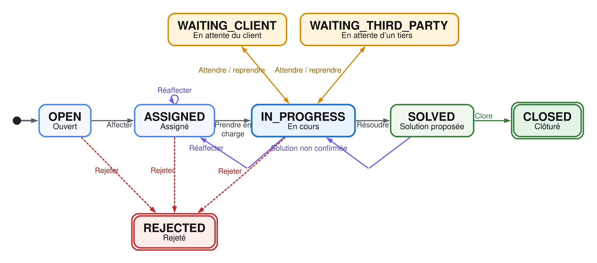
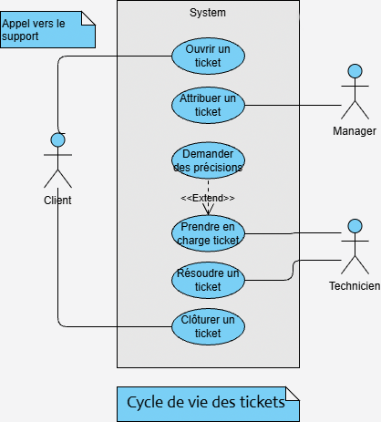

# Architecture

## Overview

Suivi MNS is a ticketing (support/helpdesk) application split into two independent applications that communicate over a REST API:

The repo is a monorepo: `backend/` and `frontend/` are two independently deployable projects (each has its own `Dockerfile` and `compose.yml`), kept together here to share a common history and documentation.

## Backend

### Stack

| Component | Choice | Role |
|---|---|---|
| Framework | Spring Boot 3.2.5 (Java 17) | REST API |
| Persistence | Spring Data JPA / Hibernate | ORM |
| Database | PostgreSQL 18 | Relational storage |
| Security | Spring Security + JJWT | Stateless JWT authentication |
| DTO ↔ Entity mapping | MapStruct | Mappers generated at build time |
| API documentation | springdoc-openapi | Auto-generated Swagger UI |
| Build | Maven | — |

### Package layout (`backend/src/main/java/com/mns/cda/suivimns`)

| Package | Content |
|---|---|
| `controller` / `controller/business` | REST entry points |
| `service`, `service/entity`, `service/business`, `service/workflow`, `service/search` | Business logic, including the ticket lifecycle engine (`service/workflow`) |
| `model`, `model/keys`, `model/groups` | JPA entities |
| `dto` (`entity`, `flat`, `details`, `search`, `workflow`, `account`, `dashboard`, `config`) | Objects exchanged with the frontend, split by use case |
| `mapper`, `mapper/entity`, `mapper/enumerate` | MapStruct entity ↔ DTO mappers |
| `security` | JWT authentication, filter, role annotations (`@IsAdmin`, `@IsManager`...) |
| `dao`, `dao/search` | Custom queries (search/filtering) |
| `enumerate` | Business enums (`StatusEnum`, `ActivityType`) |
| `exception` | Error handling |
| `config` | Spring configuration (CORS, beans...) |

### Data model

The model is centered on the `Ticket` entity, linked to business reference data (`Theme`, `Urgency`, `Impact`, `Version`/`VersionType`, `Software`/`SoftwareType`, `Client`) and to its history (`Assignment`, `Comment`, `Classification`, `History`).

**Conceptual data model (MCD)**

**Logical data model (MLD)**

The physical schema (24 tables) is generated from these JPA entities. Foreign keys mostly cascade or null out sensibly on delete — e.g. deleting a ticket cascades to its assignments, but deleting a technician only nulls out `id_technician` on their past assignments, preserving the historical record instead of losing it.

`Ticket` itself stores a **denormalized projection** of its current state (status, priority, current technician, active time, SLA deadline, overdue flag) alongside the authoritative, append-only `History`/`Assignment`/`Classification` tables. This is a deliberate read-performance tradeoff — ticket lists and dashboards read the projection directly instead of re-deriving it via joins on every request — maintained by the `service/workflow` services on every write. When adding a new derived/current-state field to `Ticket`, keep it in sync the same way rather than computing it ad hoc in a controller.

Priority isn't entered directly by the ticket creator: it's computed from urgency, impact and ticket context into a 0–100 score, which in turn drives the SLA deadline. This logic is intentionally centralized in the workflow services rather than spread across the frontend, so the scoring approach can change without touching the API contract.

### Users and roles

`AppUser` is the parent class (JPA `JOINED` inheritance) for every account type: `Admin`, `Director`, `Manager`, `Technician`, `Client`. The role is derived from the account subtype at login time and encoded as a claim in the JWT (`role`, along with `name`, `id`, `rank`).

Each controller/method is protected by a business-level annotation (`@IsAdmin`, `@IsDirector`, `@IsManager`, `@IsTechnician`, `@IsClient`, `@IsEmployee`, `@IsUser`), which wraps Spring Security's `@PreAuthorize` — see `backend/src/main/java/com/mns/cda/suivimns/security`.

### Ticket lifecycle

A ticket's status (`StatusEnum`) follows this progression:

Notably, `REJECTED` is reachable from `OPEN`, `ASSIGNED` and `IN_PROGRESS` (not only from the start), and an unconfirmed solution sends the ticket back to `IN_PROGRESS` from `SOLVED` rather than closing it — `StatusTransition` is the single source of truth for which transitions are legal; the backend rejects anything else rather than trusting the frontend to only offer valid actions.

Each transition is handled by a dedicated service under `service/workflow` (`TicketOpeningService`, `TicketAssignmentService`, `TicketProgressService`, `TicketWaitService`, `TicketSolvedService`, `TicketClosingService`, `StatusTransition`), which keeps the business rules of each step isolated (priority calculation, SLA, internal notifications...).

Every ticket carries an initial and a current priority (computed from urgency/impact — see [Data model](#data-model)), an SLA deadline (`slaDeadline`) and an overdue flag (`overdue`).

The actors driving this lifecycle map directly onto the role model:

### Search, filtering and pagination

Ticket search combines an open-ended set of optional filters (status, client, software, version, technician, dates, keyword, priority, SLA breach). Rather than a `findBy...` method per filter combination, `dao/search` builds each criterion as a `Specification` and composes only the ones present in the request; sortable fields are restricted to an explicit whitelist rather than accepting an arbitrary field name from the client. Dashboard aggregations use JPQL where the projection is simple and native SQL for time-based aggregates (e.g. average time-to-pickup via `EXTRACT(EPOCH FROM ...)`), trading some Postgres-specific coupling for readable aggregation queries.

## Frontend

### Stack

| Component | Choice | Role |
|---|---|---|
| Framework | Angular 21 (standalone, signals) | SPA |
| Styling | Tailwind CSS 4 + DaisyUI 5 | Utility-first design system |
| Charts | Chart.js / ng2-charts | Dashboards |
| Icons | Phosphor Icons | — |
| Tests | Vitest | Unit tests |

### Layout (`frontend/src/app`)

| Folder | Content |
|---|---|
| `pages` | One page per route (tickets, clients, reference data admin, knowledge base, settings...) |
| `components` | Reusable components (role dashboards, tables, generic forms, modals) |
| `services/api` | One HTTP client per REST resource (mirrors the backend controllers) |
| `services/business` | Application logic layered on top of the API services (e.g. ticket store) |
| `services/form-service`, `services/ui` | Form / UI helpers |
| `guards`, `interceptors` | Route protection and JWT injection into requests |
| `models` | TypeScript types mirroring backend DTOs |
| `validators`, `pipe` | Form validation and display transforms |

The UI adapts its content to the logged-in user's role (separate dashboards and menus for Admin, Director, Manager, Technician), with dedicated desktop and mobile views for ticket lists.

Role dashboards are functional but still a work in progress — several KPIs and charts planned for each role are not implemented yet (see [project status](../README.md#project-status)).

## Security

- Login (`POST /log-in`) checks a BCrypt-hashed password and returns a stateless JWT, signed with HS256 (secret injected via `JWT_SECRET`), carrying the user's identity and role. No route ever returns a password or its hash.
- The token is stored in the frontend's `localStorage` and attached to requests by an HTTP interceptor; "logout" only deletes the local copy — there's no server-side revocation, consistent with the token having no expiration (see below).
- Authorization is enforced on the backend by role via `@PreAuthorize` (the `Is*` annotations), plus ownership checks in the services themselves where role alone isn't enough (e.g. a client may only read their own tickets, a technician may only act on tickets assigned to them). The frontend only hides menus/actions for convenience and is not treated as a security boundary.
- DTOs validate input (`@NotNull`, `@NotBlank`, `@Size`, `@Email`, `@Min`/`@Max`); JPA queries are parameterized (no string-concatenated SQL) and sortable fields are whitelisted (see [Search, filtering and pagination](#search-filtering-and-pagination)); a global exception handler turns business/validation errors into a consistent response shape without leaking internal details.
- **Known gaps, planned as upcoming work**:
  - JWTs currently carry no expiration claim and never expire; short-lived tokens with a refresh/auto-renewal flow are planned. The `localStorage` vs. `HttpOnly` cookie tradeoff (and the CSRF strategy that comes with a cookie) hasn't been decided yet.
  - CORS is currently wide open (`allowedOrigins: *`) and should be restricted to the frontend's origin.
  - No systematic review against the OWASP Top 10 has been done yet; this is planned as a dedicated hardening pass.
  - No GDPR / accessibility (RGAA/WCAG) compliance work has started yet: no defined data retention period, no right-to-erasure/anonymization flow, no formal accessibility audit.
  - No automated, tested backup/restore procedure exists. The Postgres Docker volume survives container recreation, but that is explicitly not a backup.
  - The schema is Hibernate-generated (`ddl-auto`) rather than versioned via a migration tool (Flyway/Liquibase).

## Testing

- **Backend**: unit tests per layer (DTO validation, isolated service-level business rules like illegal status transitions or priority/SLA calculation, controller HTTP status + delegation, security/ownership checks) plus full-stack integration tests that boot the real Spring context and drive it through MockMvc with a real security config and a test-data factory — e.g. assign → pick up → hold/resume → resolve → close is covered end to end at the API level. Run with `./mvnw test`.
- **Frontend**: Vitest unit tests (`npm test`), currently weighted toward "does this component/service construct" rather than interaction behavior (clicks, form validation, filters) — called out in [Project status](../README.md#project-status) as an area to deepen, along with adding some browser-driven end-to-end coverage.
- No load/volume testing and no measured code coverage yet.

## Known issues

- **SLA/timestamp display can be off by a couple of hours on a deployed (non-local) environment.** Observed as a discrepancy between a ticket's displayed creation time and its actual creation time when running against a deployed VM, not reproducible locally. Root cause isn't confirmed; the leading hypothesis is a UTC vs. local-timezone (`Europe/Paris`) mismatch between how PostgreSQL/the host store timestamps and how the backend/Angular interpret them for display. If you're touching SLA or date-handling code, keep timestamps in UTC end-to-end and only convert at the display layer.
