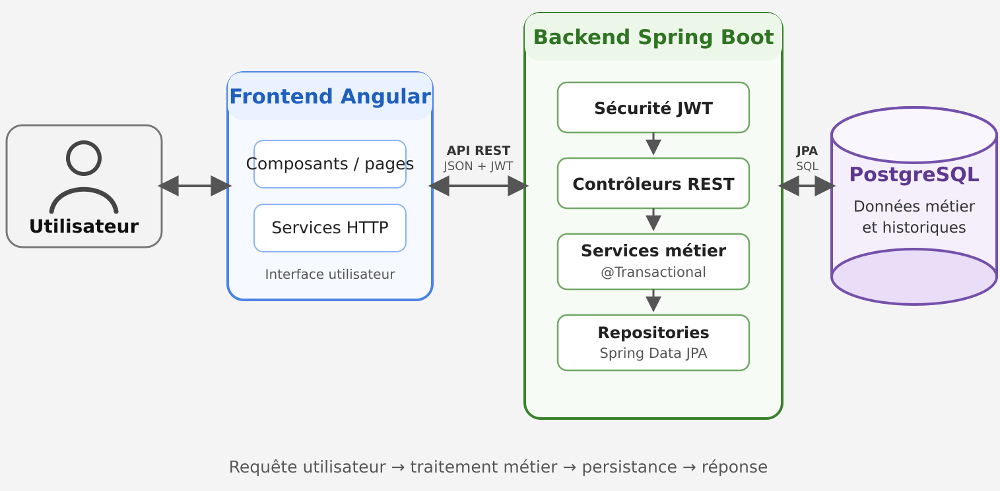

# Architecture

General, cross-cutting architecture notes. Per-app implementation details live next to each app: [backend/docs/ARCHITECTURE.md](../backend/docs/ARCHITECTURE.md) (+ [backend/docs/API.md](../backend/docs/API.md)) and [frontend/docs/ARCHITECTURE.md](../frontend/docs/ARCHITECTURE.md).

## Overview

Suivi MNS is a ticketing (support/helpdesk) application split into two independent applications that communicate over a REST API:

The repo is a monorepo: `backend/` and `frontend/` are two independently deployable projects (each has its own `Dockerfile` and `compose.yml`), kept together here to share a common history and documentation.

## Security

- Login (`POST /log-in`) checks a BCrypt-hashed password and returns a stateless JWT, signed with HS256 (secret injected via `JWT_SECRET`), carrying the user's identity and role. No route ever returns a password or its hash.
- The token is stored in the frontend's `localStorage` and attached to requests by an HTTP interceptor; "logout" only deletes the local copy — there's no server-side revocation, consistent with the token having no expiration (see below).
- Authorization is enforced on the backend by role via `@PreAuthorize` (the `Is*` annotations), plus ownership checks in the services themselves where role alone isn't enough (e.g. a client may only read their own tickets, a technician may only act on tickets assigned to them). The frontend only hides menus/actions for convenience and is not treated as a security boundary.
- Public demo (portfolio deploys only, `APP_DEMO_ENABLED`): anyone can get a trial technician account from the login page, without personal data. Abuse is bounded by a per-IP creation limit, a cap on active trial accounts, restricted rights (rank 0) and an automatic purge after 24 h; the purge also makes those accounts' non-expiring JWTs useless, since the JWT filter reloads the user on every request. Never enable it on a real deployment.
- DTOs validate input (`@NotNull`, `@NotBlank`, `@Size`, `@Email`, `@Min`/`@Max`, `@Pattern` — e.g. passwords require 8–16 characters with at least one digit, one uppercase and one lowercase letter); JPA queries are parameterized (no string-concatenated SQL) and sortable fields are whitelisted (see [backend/docs/ARCHITECTURE.md](../backend/docs/ARCHITECTURE.md#search-filtering-and-pagination)); a global exception handler turns business/validation errors into a consistent response shape without leaking internal details.
- **Known gaps, planned as upcoming work**:
  - JWTs currently carry no expiration claim and never expire; short-lived tokens with a refresh/auto-renewal flow are planned. The `localStorage` vs. `HttpOnly` cookie tradeoff (and the CSRF strategy that comes with a cookie) hasn't been decided yet.
  - CORS is currently wide open (`allowedOrigins: *`) and should be restricted to the frontend's origin.
  - No systematic review against the OWASP Top 10 has been done yet; this is planned as a dedicated hardening pass.
  - No GDPR / accessibility (RGAA/WCAG) compliance work has started yet: no defined data retention period, no right-to-erasure/anonymization flow, no formal accessibility audit.
  - No automated, tested backup/restore procedure exists. The Postgres Docker volume survives container recreation, but that is explicitly not a backup.
  - The schema is Hibernate-generated (`ddl-auto`) rather than versioned via a migration tool (Flyway/Liquibase).

## Testing

Per-app testing approach: [backend/docs/ARCHITECTURE.md#testing](../backend/docs/ARCHITECTURE.md#testing) and [frontend/docs/ARCHITECTURE.md#testing](../frontend/docs/ARCHITECTURE.md#testing).

- No load/volume testing and no measured code coverage yet, on either app.

## Known issues

- **SLA/timestamp display can be off by a couple of hours on a deployed (non-local) environment.** Observed as a discrepancy between a ticket's displayed creation time and its actual creation time when running against a deployed VM, not reproducible locally. Root cause isn't confirmed; the leading hypothesis is a UTC vs. local-timezone (`Europe/Paris`) mismatch between how PostgreSQL/the host store timestamps and how the backend/Angular interpret them for display. If you're touching SLA or date-handling code, keep timestamps in UTC end-to-end and only convert at the display layer.
  - Supporting observation (2026-10-28, local): timestamps are `LocalDateTime` (no zone), written and compared using the JVM's default timezone (e.g. `SlaService` uses `LocalDateTime.now()`), while the local `postgres:18` container runs in UTC. On a dev machine in `Europe/Paris` (UTC+1 in winter), a value written with PostgreSQL's `now()` lands one hour "earlier" than the same instant written by the backend, so a deadline set to `now() + 1h` from SQL was already past from the backend's point of view. Locally this only matters for timestamps produced on the database side, but on a deployed host whose JVM zone (often UTC) differs from the browser/users' zone, the same zone-less values would read shifted by the UTC offset — 2h in summer — which matches the reported symptom.
